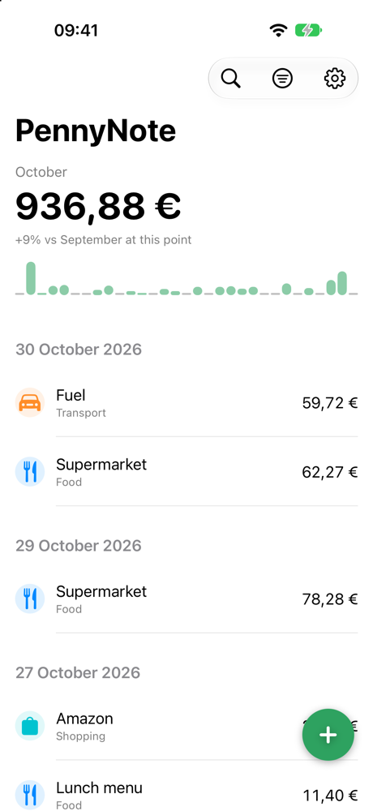
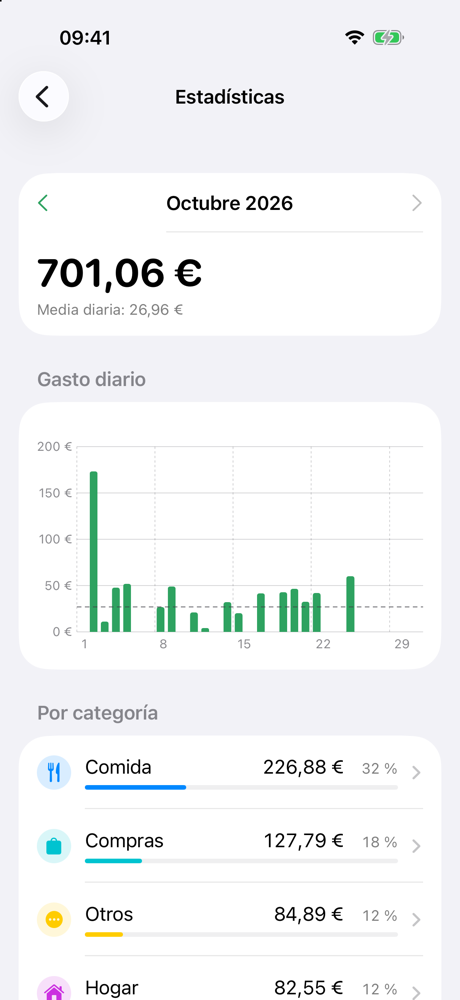
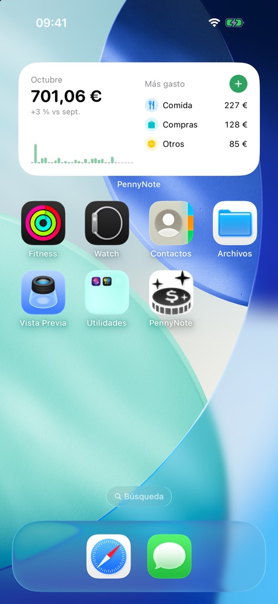

# PennyNote

A fast expense tracker for iPhone. No accounts, no login: expenses are stored on the device.

<p align="center">
  
  
  
</p>

## Features

- Log an expense in seconds with title, amount, category and payment method.
- Search and filter expenses by category and payment method.
- Daily spending chart and a comparison with the previous month right on the main screen.
- Statistics: spending per day, per category and per payment method, and the last six months.
- Home Screen widgets (small and medium) with the month's chart and top categories, and Lock Screen widgets with the total.
- Control Center button and Siri/Shortcuts action to add an expense.

## Requirements

- iOS 18 or later.
- The app's interface is in Spanish.

## Installation

PennyNote is not on the App Store. It is installed with [AltStore Classic](https://altstore.io), which signs apps with your own Apple ID.

1. Set up AltServer on your computer and AltStore on your iPhone by following the [official AltStore guide](https://faq.altstore.io).
2. In AltStore on your iPhone, go to **Sources** → **+** and add:
   ```
   https://raw.githubusercontent.com/lsopenad/PennyNote/main/altstore-source.json
   ```
3. Open the PennyNote source and install the app. New versions show up in **My Apps**.
4. Optionally add the widgets from the Home Screen and Lock Screen editors.

Apps signed with a free Apple ID expire after 7 days. AltStore refreshes them automatically while AltServer is running on a computer on the same Wi-Fi network.

## Development

See [docs/DEVELOPMENT.md](docs/DEVELOPMENT.md) (in Spanish) for building, testing and publishing releases.

## License

[MIT](LICENSE)
